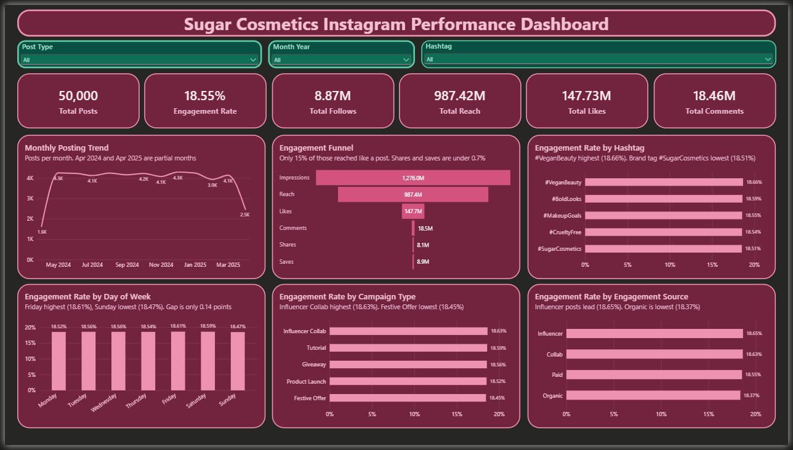
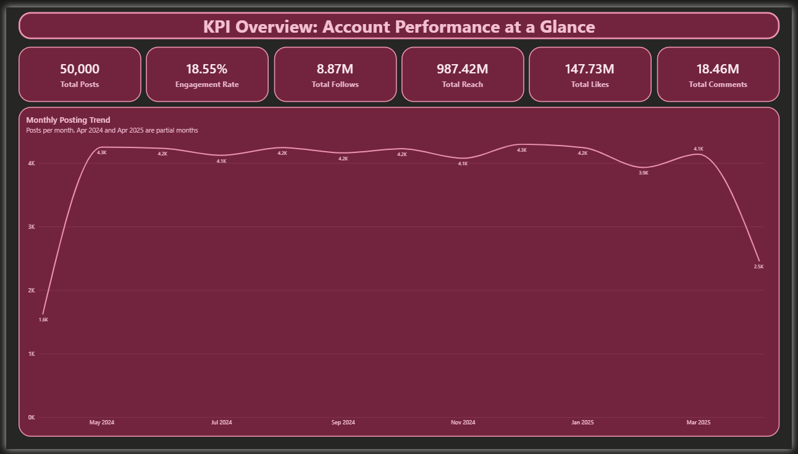
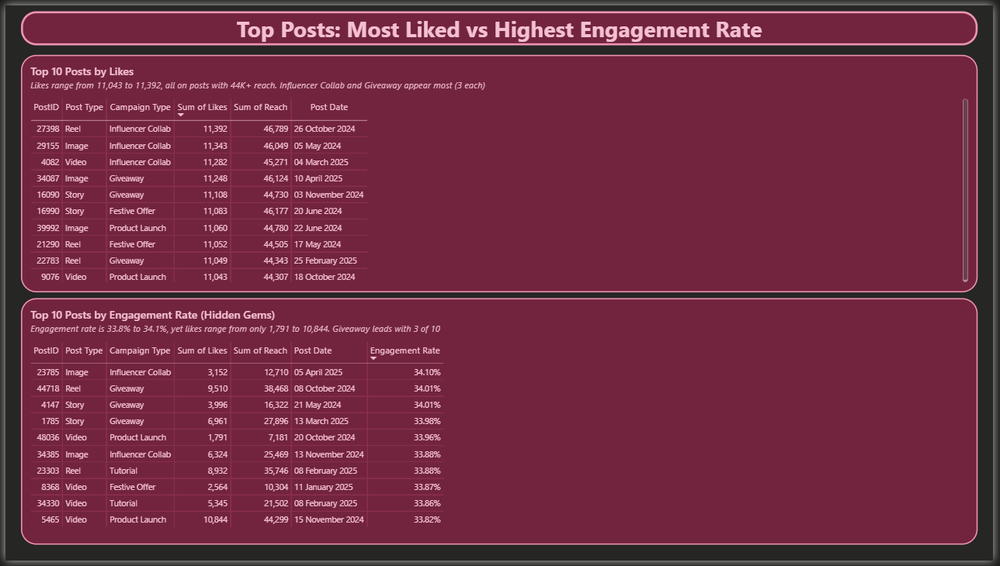
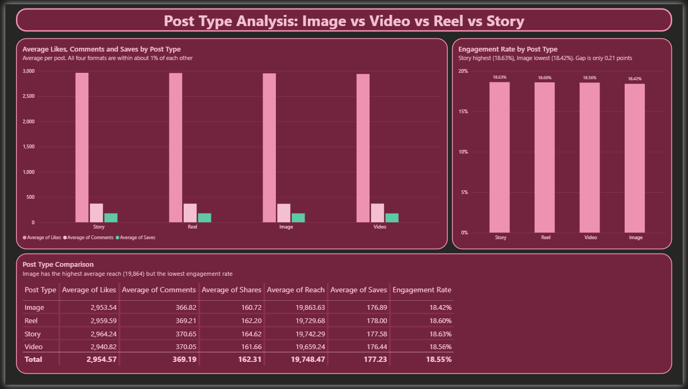
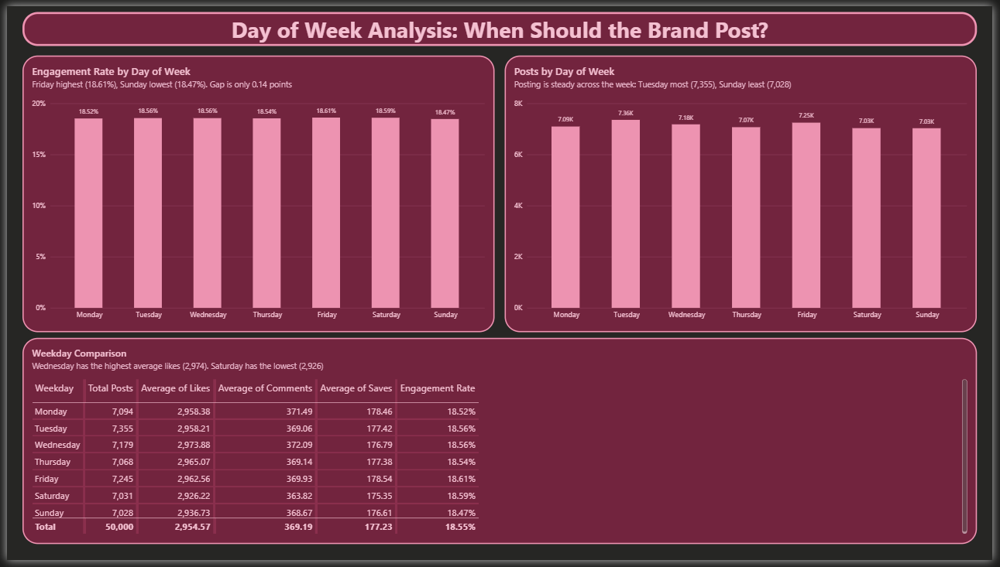
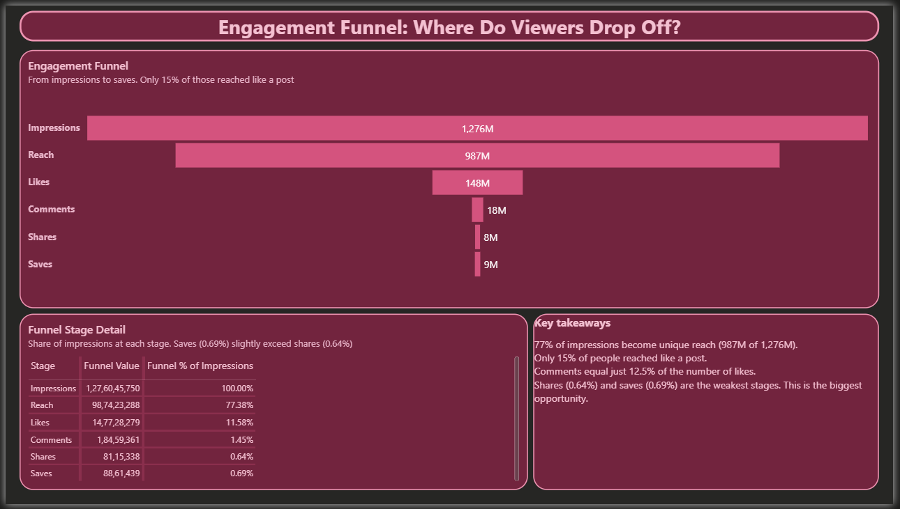
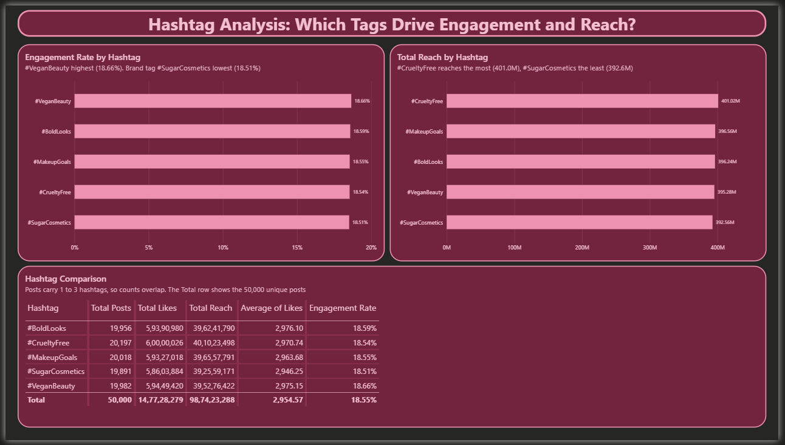
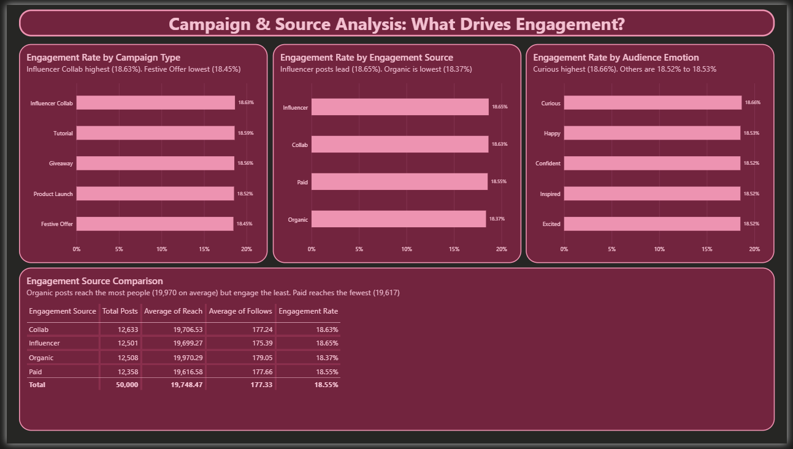

# Instagram Performance Analytics for Sugar Cosmetics

An interactive **Power BI** dashboard that analyses 50,000 Instagram posts from Sugar Cosmetics (April 2024 to April 2025). It shows how the account performs, where viewers drop off, and what the brand should do differently.



## Project overview

I acted as a social media analyst for Sugar Cosmetics, an Indian beauty brand. Given a dataset of their Instagram posts, I built a dashboard covering overall performance, top posts, post types, posting days, the engagement funnel and hashtags, then turned the findings into strategic recommendations.

## Dataset

- 50,000 posts and 14 columns, from April 2024 to April 2025
- Columns: Post Date, Post Type, Campaign Type, Hashtags, Audience Emotion, Engagement Source, Impressions, Reach, Likes, Comments, Shares, Saves, Profile Visits, Follows
- No missing values or duplicates
- Post types are Image, Video, Reel and Story (no Carousel), and there is no caption column
- **Engagement rate** = (Likes + Comments + Shares + Saves) / Reach

## Tools and skills

- Power BI Desktop
- Power Query (data types, helper columns, splitting hashtags into their own table)
- DAX (measures such as Total Posts, Total Engagement and Engagement Rate)
- Data modelling (one-to-many relationship between Posts and Hashtags)
- Dashboard design (custom theme, slicers, cross-filtering, KPI cards)

## Report pages

| Page | What it shows |
|---|---|
| KPI Overview | Total posts, reach, likes, comments, follows, engagement rate, and the monthly posting trend |
| Top Posts | Top 10 posts by likes and top 10 by engagement rate |
| Post Type Analysis | Average likes, comments, saves and engagement rate by post type |
| Day of Week Analysis | Engagement and posting volume by weekday |
| Engagement Funnel | Impressions, reach, likes, comments, shares and saves |
| Hashtag Analysis | Engagement and reach for each hashtag |
| Campaign and Source Analysis | Engagement by campaign type, engagement source and audience emotion |
| Dashboard | Everything combined, with slicers for Post Type, Month Year and Hashtag |

## Screenshots









## Key findings

- **Steady posting:** about 4,000 posts a month, with an overall engagement rate of **18.55%**. April 2024 and April 2025 are partial months.
- **Format, weekday and hashtag barely matter.** Story (18.63%) vs Image (18.42%), Friday (18.61%) vs Sunday (18.47%), and #VeganBeauty (18.66%) vs #SugarCosmetics (18.51%) are all within about 0.2 points.
- **The funnel leaks after reach.** 77% of impressions become reach, but only about 15% of the people reached like a post. Shares (0.64%) and saves (0.69%) are the weakest stages.
- **Influencer-led content beats organic.** Influencer (18.65%) and Collab (18.63%) posts outperform Organic (18.37%), even though organic has the highest reach per post.
- **Hidden gems:** the top posts by engagement rate (about 34%) are different from the most liked posts, and some have fewer than 2,000 likes.

## Recommendations

1. **When to post:** Friday and Saturday for key launches, but keep posting daily because the gap is small.
2. **What to post:** more influencer collaborations, Story and Reel formats, and curious, question-led hooks. Rework the Festive Offer creative, the weakest campaign.
3. **Grow engagement and followers:** add save and share calls to action, ask questions, use 2 to 3 values-based hashtags (#VeganBeauty, #CrueltyFree), and improve the profile, since about 30% of profile visits turn into follows.
4. **Campaign tests:** an influencer tutorial series, a Friday vs Wednesday launch, values-based hashtags vs the brand tag, a Festive Offer refresh, and a month of "save for later" calls to action.

## Limitations

- Most differences between categories are under one percentage point, so the recommendations should be treated as tests.
- Hashtag totals overlap, because one post can carry up to three hashtags.
- The dataset has no captions, creative details or follower baseline.

## Repository structure

```
data/         Excel dataset
powerbi/      Power BI report (.pbix) and custom theme (.json)
slides/       Presentation of the findings
screenshots/  Images of every report page
docs/         Project write-up
```

## How to open the project

1. Download `powerbi/Sugar_Cosmetics_Instagram_Analysis.pbix`.
2. Open it in **Power BI Desktop** (Windows only, free from the Microsoft Store).
3. To reuse the theme, go to Design, Themes, Browse for themes, and select `Sugar_Cosmetics_Dark_Theme.json`.

## Author

**Saish Bhalchandra Bore**
[LinkedIn](ADD-YOUR-LINKEDIN-LINK-HERE)
